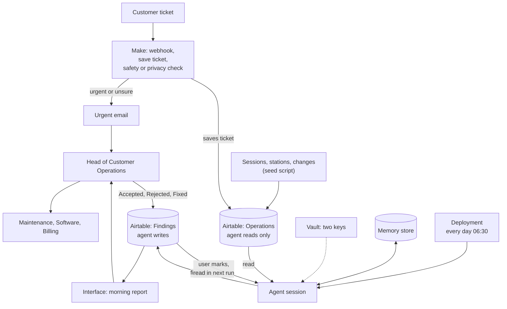
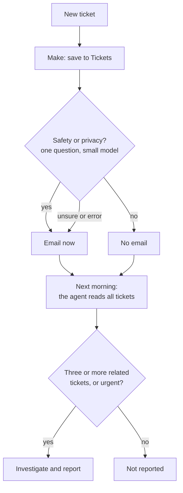
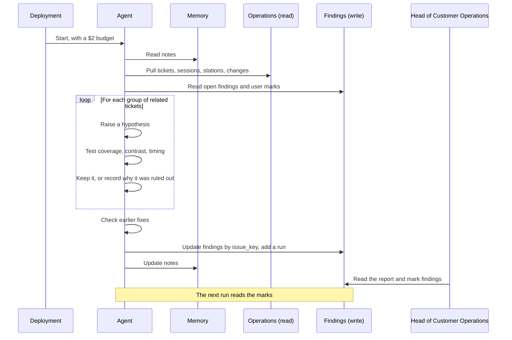
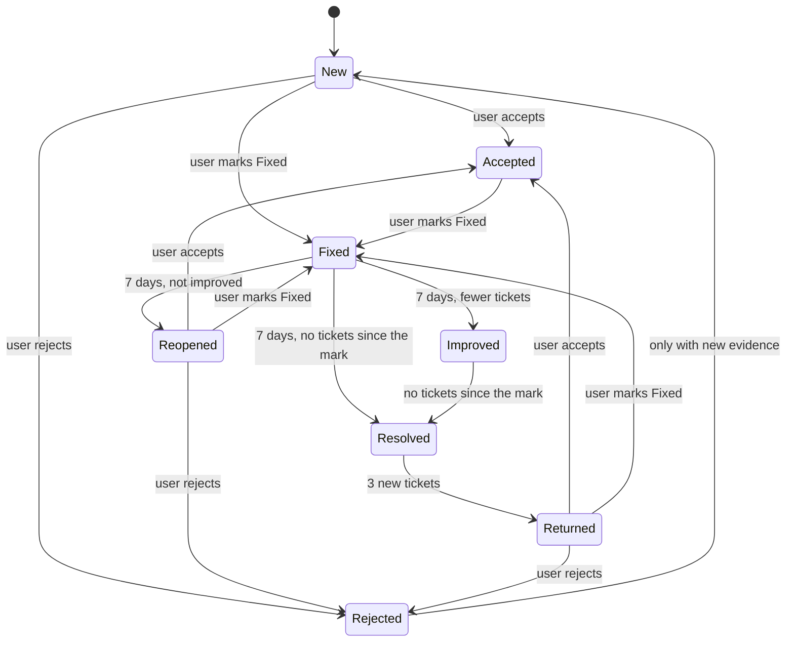
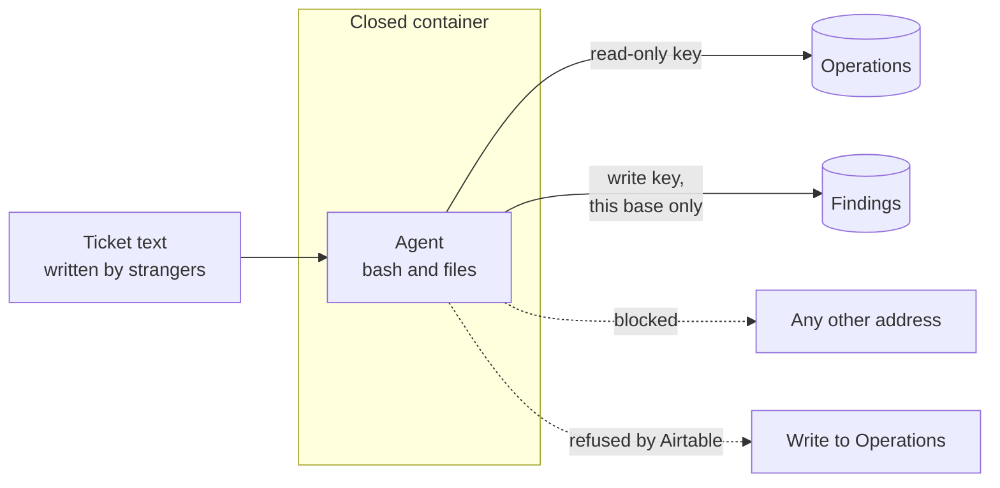

# Architecture - Electric Wize Complaint Investigator

What each part does and why: [SPEC.md](SPEC.md). This file shows where information comes from, where it goes, and what starts each step.

## The whole system

In the assignment, the sessions, stations and changes are loaded by a seed script. In a real company they come from the charging platform.

## What starts each flow

| Trigger | What runs | Output |
|---|---|---|
| A customer ticket arrives | Make scenario (webhook) | A row in Tickets. An email if urgent |
| Every day, 06:30 Asia/Jerusalem | The agent (deployment) | Findings, a row in Runs, the report, memory notes |
| The user marks a finding | Nothing at once. The agent reads the mark in its next run | Fix check, or a lesson from a rejection |
| A person presses Run | The agent, by hand | The same as the daily run, for tests |

## Two tracks for a ticket

The fast track is a workflow, because its steps are known. The investigation is an agent, because they are not.

## One morning run

## The feedback loop

Reopened and Returned keep their status and stay in every report until the user marks the finding again: Accepted, Rejected or Fixed. The status changes only when a mark is newer than the row's `last_seen`. **New** comes back only for a Rejected finding with new evidence.

## Where each kind of information lives

| Information | Its one home | Who writes | Who reads |
|---|---|---|---|
| Tickets | Operations | Make | Agent |
| Sessions, stations, changes | Operations | Seed script (a real company: the charging platform) | Agent |
| Findings and their status | Findings | Agent | User, agent |
| User marks | Findings, `user_` fields | User | Agent |
| Hypotheses, ruled-out causes, lessons | Memory store | Agent | Agent, a person once a week |
| Keys | Vault | A person, once | Nobody. Added to requests on the way out |
| Instructions, model, tools | Agent version, with a copy in this repository | A person | Platform |
| Full record of a run | Session transcript and output files | Platform | A person |

## Trust boundaries

- **The limit is in the key, not in the prompt.** The instructions say not to change company data. The key makes it impossible.
- **The keys are not in the room.** The container holds placeholders. The platform swaps in the real value after the request leaves, for `api.airtable.com` only.
- **What remains possible:** the agent can damage its own Findings, and could reach another Airtable account. See "Remaining risk" in SPEC.md.

## Platform settings

| Screen | Setting |
|---|---|
| Agent | `electric-wize-investigator`, `claude-haiku-5-5` while building, then the cheapest model that passes all planted cases (see SPEC.md, "The agent, by its five parts"), effort `high`. `bash`, `read`, `write`, `edit`, `grep`, `glob` on and allowed. `web_search`, `web_fetch` off. No skill: the Airtable calls are in the instructions |
| Environment | `electric-wize-closed`: cloud, limited network, allowed host `api.airtable.com`, no package installs |
| Vault | `electric-wize-airtable`: `AIRTABLE_OPS_READ`, `AIRTABLE_FINDINGS_WRITE`. Environment variables, header only, allowed host `api.airtable.com` |
| Memory store | `charging-ops-notes`, read and write |
| Session | Started by hand first, read line by line |
| Deployment | `electric-wize-every-morning`, 06:30 Asia/Jerusalem, pinned version, $2 budget, outcome with a rubric, at most 3 revisions |

Tickets and the report are in Hebrew. The rubric repeats the checks in "Done means" that can be read from the report: at most three problems, evidence for each, no cause without High or Medium, and what was ruled out.

## When something fails

| Failure | What happens |
|---|---|
| Airtable cannot be read | The run says so and publishes nothing |
| A write fails halfway | The next run repeats it safely, by `issue_key` |
| The budget is reached | The run pauses. Publishing is the last step, so a pause before it publishes nothing. A pause in the middle of publishing can leave some rows updated: the next run repeats the writes by `issue_key` |
| The run did not start | The deployment's run record shows the error |
| Make's check fails | The email is sent anyway |
| Make is down | The ticket is not saved. Accepted for the assignment; a real company needs an alert on the scenario |
| Memory is wrong | Conclusions are checked against Airtable. The note is rolled back |

## Cost

- **Agent:** tokens plus $0.08 for each hour a session is running. Waiting is not charged. Budget: $2 per run. The first full run cost $0.07 (Haiku 5.5, effort high, 2026-11-25). Every run is recorded in `runs/`.
- **Airtable:** about 10 read calls and a few writes per run, within the free plan's 1,000 a month.
- **Make:** the cost per ticket is measured when the scenario is built.
